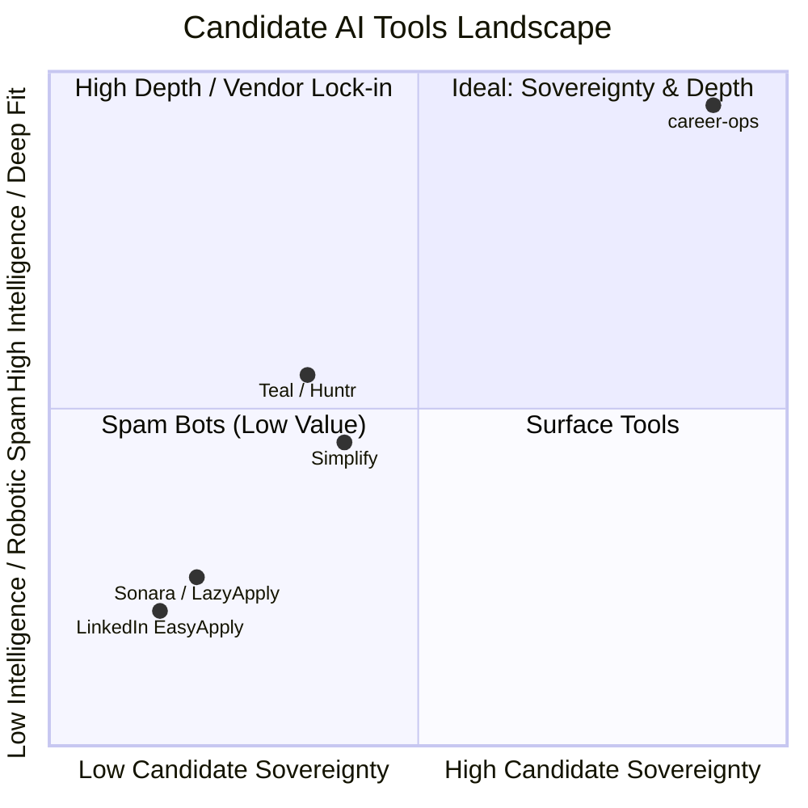

# Product Vision & Mission — career-ops

## Purpose
Defines the philosophical foundation, core principles, and long-term aspirational trajectory of career-ops.

## Scope
Applies to all software engineering, product design, community contributions, and business decisions across the ecosystem.

## Overview
Recruiting has become an asymmetric technological arms race. Employers deploy enterprise AI filters to screen thousands of applicants, while commercial "job bots" spam low-quality applications across the web. Job seekers are caught in the middle: burned out, ghosted, and forced into exhausting manual workflows.

**career-ops** exists to restore balance to this relationship by placing an enterprise-grade AI operating system directly on the candidate's machine.

## Diagrams

## Technical Details

### The Four Pillars
1. **Candidate Sovereignty**: You own your data. Your resume, notes, application history, and interview stories stay on your drive in plain text files.
2. **Deterministic Fact Grounding**: Generative AI must be chained to verifiable truth. We reject resume "enhancements" that invent experiences or exaggerate achievements.
3. **High-Signal Engagement**: We reject the "spray and pray" doctrine. Applying to 10 highly vetted roles with tailored proof points beats spamming 500 companies with generic PDF resumes.
4. **Architectural Agnosticism**: No vendor lock-in. Compatible with Claude Code, Cursor, Codex, OpenCode, Antigravity, or local Ollama instances.

## Best Practices
- Resist features that promote low-effort application spam.
- Prioritize human agency: assist the candidate's critical judgment rather than replacing it.

## Examples
- When a job score is below 4.0, career-ops explicitly recommends *not* applying, preserving the candidate's mental energy for high-probability opportunities.

## Future Enhancements
- Establishing an open, decentralized candidate verification protocol that allows engineers to share verified proof points with hiring managers without intermediaries.
