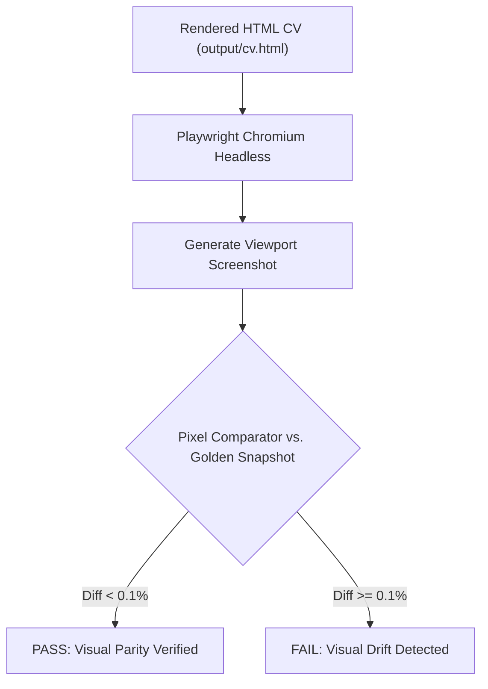

# End-to-End (E2E) & Visual Testing — career-ops

## Purpose
Covers visual regression testing for rendered PDF resumes and browser-driven portal scrapers.

## Scope
Applies to `tests/cv-visual/`, `playwright.cv.config.mjs`, and Playwright scrapers.

## Overview
Because a minor CSS drift can push a tailored resume onto an awkward second page or misalign header margins, career-ops executes automated pixel-diff visual testing using Playwright Chromium.

## Diagrams



## Technical Details

### Visual Testing Configuration
- Configuration file: `playwright.cv.config.mjs`.
- Tests location: `tests/cv-visual/cv-visual.spec.mjs`.
- Viewport: Standard Letter (`8.5in x 11in`) and A4 at 96 DPI.
- Snapshot update command: `npm run test:cv-visual:update`.

## Best Practices
- Run visual tests in a consistent Linux container in CI to prevent font-rendering discrepancies between macOS and Windows.

## Examples
```bash
# Run CV visual regression tests
npm run test:cv-visual
```

## Future Enhancements
- Automated Playwright E2E testing for the Next.js Web UI Kanban board.
