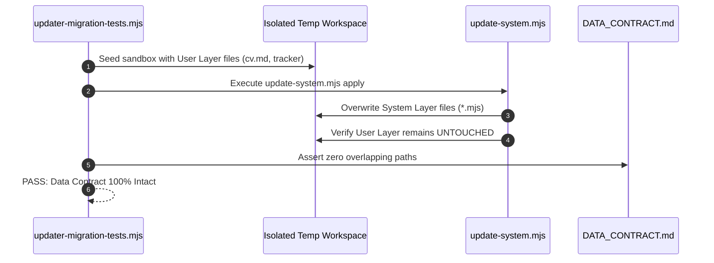

# Integration Testing Guide — career-ops

## Purpose
Specifies multi-component integration testing, pipeline synchronization, and updater safety validation.

## Scope
Covers `updater-migration-tests.mjs`, `verify-pipeline.mjs`, and multi-step workflows.

## Overview
Integration tests verify that disparate subsystems (CLI scripts, SQLite indices, lock files, and Markdown tables) interact harmoniously without race conditions or data loss.

## Diagrams



## Technical Details

### Integration Test Targets
1. **Pipeline Verification (`verify-pipeline.mjs`)**:
   - Asserts tracker status validity against `templates/states.yml`.
   - Flags orphaned report links or mismatched report IDs.
2. **Updater Migration Tests (`updater-migration-tests.mjs`)**:
   - Simulates upgrading from legacy career-ops versions to the latest release.
   - Validates that user customizations in `modes/_profile.md` survive intact.

## Best Practices
- Always run integration tests within isolated sandbox directories created via `mkdtempSync`.

## Examples
```bash
# Run pipeline integrity verification
npm run verify
```

## Future Enhancements
- Simulated concurrent batch runner race-condition testing in CI.
