# Performance Testing & Benchmarking — career-ops

## Purpose
Describes how to measure career-ops performance by hand. It does not record benchmark results or budgets, because the repository contains no benchmark suite.

## Scope
Covers ATS scraping, SQLite indexing and Playwright PDF generation.

## Overview
Performance matters when candidates sweep hundreds of company boards. The timings below are illustrative only and were not measured in this repository.

## Diagrams

```mermaid
gantt
    title Illustrative Single-Offer Flow (not measured)
    dateFormat X
    axisFormat %s ms
    section Pre-Flight
    Liveness Check (check-liveness.mjs) :0, 450
    Blacklist & Dealbreaker Gate       :450, 480
    section AI Inference
    A-H Deep Evaluation (LLM API)      :480, 2800
    section Asset Prep
    Fact Verification (verify-cv-facts):2800, 2920
    Playwright PDF Generation          :2920, 4200
    SQLite Derived Index Sync          :4200, 4250
```



## Technical Details

### Performance Budgets
The repository has no benchmark suite that enforces latency or throughput targets, so this document does not set any. Measure with the commands below and record the numbers yourself before treating them as a baseline.

## Best Practices
- Use batch rendering (`generate-pdf.mjs --batch=<manifest.json>`) to share a single Chromium browser instance across multiple documents.

## Examples
```bash
# Benchmark SQLite re-indexing speed
time node tracker.mjs sync
```

## Future Enhancements
- Continuous performance benchmarking tracked in GitHub Actions.
