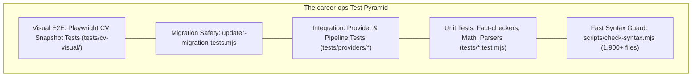

# Testing Strategy & QA Architecture — career-ops

## Purpose
Establishes the quality assurance philosophy, test pyramid, test categorization, and CI gating standards.

## Scope
Covers syntax linting, unit tests, provider integration tests, visual regression, and migration safety.

## Overview
career-ops enforces rigorous, multi-layered quality gates. Because candidate reputation and application data integrity are at stake, test suites cover everything from regex SSRF protections to visual pixel drift in rendered CVs.

## Diagrams



## Technical Details

### Quality Gate Hierarchy
1. **Syntax Linting (`scripts/check-syntax.mjs`)**:
   - Compiles every `.mjs` file using Node's native parser without executing code.
   - Executes across 1,900+ files in under 4 seconds.
2. **Auto-Discovered Unit Suites (`tests/**/*.test.mjs`)**:
   - Discovered automatically by `test-all.mjs`.
   - Uses zero-dependency assertions from `tests/helpers.mjs`.
3. **Provider Contract Tests (`tests/providers/*.test.mjs`)**:
   - Asserts that every ATS scraper parses live or mocked job payloads correctly into standard `Job` objects.
4. **Data Contract & Migration Gates (`updater-migration-tests.mjs`)**:
   - Guarantees that updates never touch User Layer files and that rollback mechanisms function cleanly.
5. **Visual CV Regression (`playwright.cv.config.mjs`)**:
   - Playwright renders PDFs and compares pixel-diff snapshots against golden reference images.

## Best Practices
- Never check in tests that invoke `process.exit()`.
- Always mock external network calls in provider unit tests using local fixture files.

## Examples
```bash
# Full comprehensive test run
node test-all.mjs

# Fast syntax check
npm run lint
```

## Future Enhancements
- Automated fuzz testing for job posting HTML extraction.
