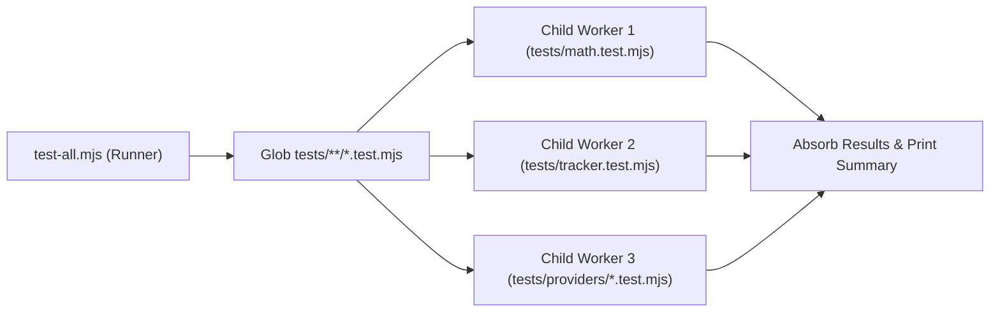

# Unit Testing Guide — career-ops

## Purpose
Instructions and best practices for authoring, running, and debugging unit test suites.

## Scope
Applies to `tests/**/*.test.mjs`.

## Overview
Unit tests in career-ops are fast, isolated, and auto-discovered. Suites run in parallel worker processes, sharing execution status through a centralized runner.

## Diagrams



## Technical Details

### Authoring Standards
- Test files must match `tests/**/*.test.mjs`.
- Import assertions and lifecycle utilities from `tests/helpers.mjs`:
  ```javascript
  import { pass, fail, results } from './helpers.mjs';

  export async function run() {
    if (1 + 1 === 2) {
      pass('Basic math passes');
    } else {
      fail('Basic math failed');
    }
  }
  ```
- Never invoke `process.exit()` or `finish()`.

## Best Practices
- Keep tests hermetic: clean up temporary fixture files in `finally` blocks using `rmSync` with retries.

## Examples
```bash
# Run a specific unit test
node test-all.mjs --only tracker-columns
```

## Future Enhancements
- Transition to Node.js native test runner (`node:test`) across all legacy test suites.
