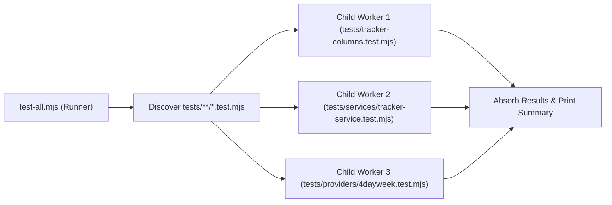

# Unit Testing Guide — career-ops

## Purpose
Instructions and best practices for authoring, running, and debugging unit test suites.

## Scope
Applies to `tests/**/*.test.mjs`.

## Overview
Unit tests in career-ops are fast, isolated, and auto-discovered. Suites run in parallel worker processes, sharing execution status through a centralized runner.

## Diagrams



## Technical Details

### Authoring Standards
- Test files must match `tests/**/*.test.mjs`. `test-all.mjs` discovers them recursively, in sorted order, and skips `tests/cv-visual/cv-visual.test.mjs` because that file is a Playwright suite run by its own job (see `E2ETesting.md`).
- Most suites (about 350 files) use the `node:test` runner. `test-all.mjs` classifies each file and runs it in a child process:
  ```javascript
  import test from 'node:test';
  import assert from 'node:assert/strict';

  test('basic math passes', () => {
    assert.equal(1 + 1, 2);
  });
  ```
- A few older suites use the helpers style from `tests/helpers.mjs` (`pass`, `fail`, `results`, with an exported `run()`). Do not call `process.exit()` or `finish()` in a suite.
- `npm test` runs `node test-all.mjs --quick`.

## Best Practices
- Keep tests hermetic: clean up temporary fixture files in `finally` blocks using `rmSync` with retries.

## Examples
```bash
# Run the suites whose path matches a substring
node test-all.mjs --only tracker-columns

# Run one file directly with the node:test runner
node --test tests/tracker-columns.test.mjs
```

## Future Enhancements
- Transition to Node.js native test runner (`node:test`) across all legacy test suites.
