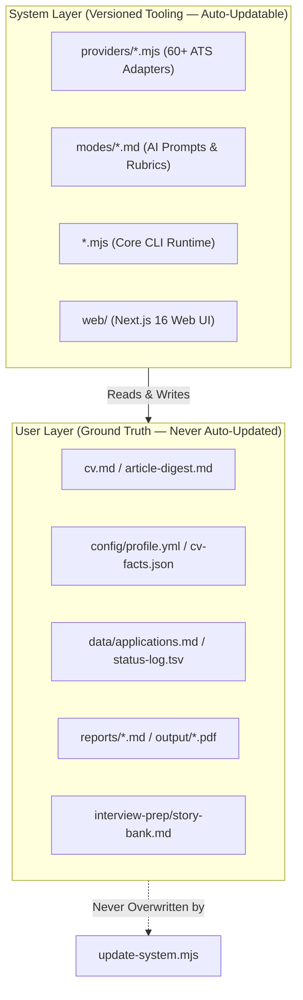

# Rolewright engine

The engine behind [Rolewright](../../README.md): the fact gate, PDF renderer and resume checks the hosted app calls, plus the career-ops CLI scripts, prompt modes and tests they came from. Based on [career-ops](https://github.com/career-ops-hq/career-ops) (MIT). Upstream updates are disabled in this fork.

## What is career-ops?

`career-ops` is a private, local-first candidate operations system. It automates every step of the job search—from discovering openings via direct ATS APIs to validating posting liveness, detecting ghost postings, generating fact-checked resumes, and tracking progress—directly on your machine.

### The Four Tenets
1. **Local-First & Sovereign**: Runs on your files. No candidate data ever leaves your computer without your explicit authorization.
2. **AI-Agnostic Engine**: Prompts live in Markdown files under `modes/`. Executes inside Claude Code, Cursor, Codex, OpenCode, Antigravity, Gemini CLI, Grok Build CLI, or offline with local Ollama models.
3. **Deterministic Fact Grounding**: Generative AI is strictly bounded by `verify-cv-facts.mjs`. It will never invent metrics, skills, or employment history.
4. **Human-in-the-Loop (HITL)**: career-ops prepares, scores, filters, and drafts. You review, verify, and click Submit. It never spams applications.

| Guarantee | Rule |
|---|---|
| Human in the loop | It prepares, scores and drafts; you review and press Submit. It never submits an application for you. <!-- hitl: absolute guarantee. Do not add a hedge such as usually, by default, unless or automatically to this row. --> |

---

## Executive Feature Matrix

| Capability | What it does | Engineering Mechanism |
| :--- | :--- | :--- |
| **Zero-Token Discovery** | Finds jobs from Greenhouse, Ashby, Lever, Workday, etc. without LLM API costs. | 60+ modular REST/JSON/RSS adapters in `providers/`. |
| **Deterministic Liveness Gate** | Verifies a posting is live before spending tokens on evaluation. | `check-liveness.mjs` inspects HTTP status and DOM elements. |
| **Anti-Ghost Legitimacy (Block G)** | Flags scam jobs, zombie postings, and repost churn. | Cross-references posting age, repost cadence, and layoff alerts. |
| **Holistic 5-Dimension Scoring** | Evaluates CV match, North Star fit, comp, culture, and red flags (1.0–5.0). | Integrated qualitative judgment in `modes/_shared.md`. |
| **Fact-Gated Tailoring** | Tailors CV phrasing while strictly forbidding hallucinations. | `verify-cv-facts.mjs` verifies every metric against `cv.md`. |
| **ATS-Parseable PDF & LaTeX** | Generates single-column, ATS-optimized PDFs and Overleaf-ready LaTeX. | `generate-pdf.mjs` (Playwright Chromium) and `generate-latex.mjs`. |
| **STAR Story Bank with Provenance** | Prepares interview responses grounded in your real achievements. | `story-bank.mjs` with strict provenance markers (#2947). |
| **Derived CQRS SQLite Index** | Blazing-fast querying over Markdown tracker tables. | Native `node:sqlite` derived cache in `tracker.mjs` (RFC #918). |

---

## Quick Start (Installation)

### Prerequisites
- **Node.js**: `^22.13.0 || >=23.4.0`
- **Git**: For version tracking and safe system updates
- **AI Coding CLI**: Claude Code, Cursor, Codex, Antigravity CLI, or OpenCode

```bash
# 1. Clone the repository
git clone https://github.com/career-ops-hq/career-ops.git
cd career-ops

# 2. Install dependencies & Playwright Chromium
npm install

# 3. Verify system health
npm run doctor

# 4. Initialize configuration templates
cp .env.example .env
cp config/profile.example.yml config/profile.yml
cp cv-facts.example.json config/cv-facts.json
```

### Initial Setup
1. Author your master CV in `cv.md` (Markdown format, chronological experience).
2. Configure your target archetypes, location rules, and comp floors in `config/profile.yml`.
3. Add curated companies or job boards to `portals.yml`.

---

## Everyday Usage

Paste a job posting URL or raw JD text directly into your AI coding CLI:

```bash
# In Claude Code, Antigravity, or OpenCode:
/rolewright oferta https://jobs.ashbyhq.com/company/job-id

# Plain language in any CLI (Cursor, Codex, Grok, Qwen):
"Evaluate this JD with career-ops: https://jobs.lever.co/company/job-id"
```

The system will:
1. Confirm the posting is live (skips dead links automatically).
2. Screen for blacklist and candidate dealbreakers.
3. Deliver a comprehensive 8-block evaluation (A–H) with a holistic 1–5 score.
4. If score $\ge 4.0$, tailor your CV and compile a verified PDF into `output/`.
5. Record the application row in `data/applications.md` and transition ledger.

### Command Reference

| Stage | Mode / Script | Action |
| :--- | :--- | :--- |
| **Discovery** | `scan` / `scan:full` | Scans configured portals or sweeps full ATS public databases. |
| **Triage** | `pipeline` | Evaluates pending URLs in `data/pipeline.md` sequentially. |
| **Evaluation** | `oferta` / `job` | Full 8-block analysis (CV match, comp, culture, ghost check). |
| **Application** | `apply` | Generates verified form answers and outreach emails. |
| **Tracking** | `tracker` | Inspects and filters your application pipeline. |
| **Cadence** | `followup` | Identifies overdue follow-ups and drafts polite check-in notes. |
| **Interview** | `interview` | Prepares company-specific STAR stories and red-flag questions. |
| **Learning** | `retro` | Captures your feedback and updates your persistent house rules. |

---

## User Interfaces

### Legacy local web UI (`web/`)
Kept as reference for the tracker rebuild in `apps/web`, then deleted (see `docs/adr` at the repository root):
```bash
cd web
npm install
npm run build
npm start
# Open http://localhost:3000
```

---

## Architecture & Data Contract

career-ops is built on a strict boundary between the **System Layer** (the versioned engine) and the **User Layer** (your private data):



For full architectural specifications, see:
- High-Level Doctrine: [ARCHITECTURE.md](ARCHITECTURE.md)
- Data Contract Boundary: [DATA_CONTRACT.md](DATA_CONTRACT.md)
- Runtime Flows: [docs/architecture/SystemArchitecture.md](docs/architecture/SystemArchitecture.md)

---

## Comprehensive Documentation Suite

| Category | Focus | Key Documents |
| :--- | :--- | :--- |
| **Architecture** | System & Technical Design | [System](docs/architecture/SystemArchitecture.md) · [Frontend](docs/architecture/FrontendArchitecture.md) · [Backend](docs/architecture/BackendArchitecture.md) · [Database](docs/architecture/DatabaseArchitecture.md) · [AI](docs/architecture/AIArchitecture.md) · [Agent](docs/architecture/AgentArchitecture.md) · [Security](docs/architecture/SecurityArchitecture.md) · [Infra](docs/architecture/InfrastructureArchitecture.md) |
| **Development** | Setup & Standards | [Setup Guide](docs/development/SetupGuide.md) · [Local Dev](docs/development/LocalDevelopment.md) · [Coding Standards](docs/development/CodingStandards.md) · [Branching](docs/development/BranchingStrategy.md) · [Contributing](docs/development/ContributionGuide.md) · [Env Vars](docs/development/EnvironmentVariables.md) · [API Guide](docs/development/APIDevelopmentGuide.md) |
| **Frontend** | Web UI & Design Tokens | [Design System](docs/frontend/DesignSystem.md) · [Component Library](docs/frontend/ComponentLibrary.md) · [State Management](docs/frontend/StateManagement.md) · [Routing](docs/frontend/RoutingArchitecture.md) |
| **Backend** | Services & API Reference | [API Reference](docs/backend/APIReference.md) · [Service Architecture](docs/backend/ServiceArchitecture.md) · [Database Schema](docs/backend/DatabaseSchema.md) · [Authentication](docs/backend/Authentication.md) |
| **AI System** | Prompts, Agents & Gates | [Prompt Library](docs/ai/PromptLibrary.md) · [Agent Workflows](docs/ai/AgentWorkflows.md) · [LLM Routing](docs/ai/LLMArchitecture.md) · [Evaluation Rubric](docs/ai/EvaluationFramework.md) · [Local RAG](docs/ai/RAGArchitecture.md) · [Tool Calling](docs/ai/ToolCallingArchitecture.md) |
| **Testing** | QA Strategy & Test Suites | [Testing Strategy](docs/testing/TestingStrategy.md) · [Unit Testing](docs/testing/UnitTesting.md) · [Integration](docs/testing/IntegrationTesting.md) · [E2E Visual](docs/testing/E2ETesting.md) · [Performance](docs/testing/PerformanceTesting.md) |
| **Deployment** | DevOps, CI/CD, Scaling | [Deployment Guide](docs/deployment/DeploymentGuide.md) · [CI/CD](docs/deployment/CI-CD.md) · [Monitoring](docs/deployment/Monitoring.md) · [Scaling](docs/deployment/Scaling.md) · [Disaster Recovery](docs/deployment/DisasterRecovery.md) |
| **Structure** | Full Repository Map | [PROJECT_STRUCTURE.md](PROJECT_STRUCTURE.md) |

---

## Credits

Based on career-ops by Santiago Fernández de Valderrama and its contributors, under the [MIT License](LICENSE). Rolewright is independent and not endorsed by that project.
